# Architecture et chemin de commercialisation

## Trois niveaux avec une valeur distincte

| Niveau | Valeur client | État de cette branche |
| --- | --- | --- |
| ORIGIN RÉVOLUTION, gratuit | Mettre des mots sur une relation et choisir un premier geste | Miroir guidé et expériences locales du pack réutilisés, aucun coût Claude par interaction |
| ORIGIN PREMIUM | Lecture personnalisée et livret conservable | Générateurs commerciaux préservés ; dossier et parcours de démonstration raccordés |
| ORIGIN VIVANT | Conserver et enrichir ses souvenirs, son arbre et son chemin | Fonctions locales, compte et sauvegarde volontaire testés ; services récurrents distants à valider |

Les tarifs 9,90 €/mois, 19,90 €/mois et 19 € figurent dans le pack ; ils ne sont
ni activés, ni validés commercialement par ce développement. Aucune promesse de
rentabilité ou de rétention n'est déduite de la démonstration.

## Organisation livrée

```text
hostinger/vivant/          Front officiel + API PHP/MySQL adaptés
  origin-vivant.*          Miroir, expériences, carnet existants
  arbre-vivant.html        Arbre existant
  origin-commercial.js    Comptes et commerce existants
  origin-storage.js       Sauvegarde versionnée carnet + arbre
  origin-integration.js   Préparation volontaire d'un dossier de livret
app.py                    Moteur commercial Python, logique inchangée
demo.py + demo_support.py  Prestataires simulés, point d'entrée séparé
platform_demo.py          Façade LOCALE ; refuse une API PHP de production
tools/vivant/             Conteneurs et routeur locaux de test
pack-docs/                Notices originales, empreintes, migration de test
```

Le front et l'API PHP restent compatibles avec un site PHP/HTML Hostinger.
Ils ne doivent pas remplacer un site Hostinger Website Builder. Un sous-domaine
de préproduction distinct ou un hébergement PHP dédié sera nécessaire selon le
type du compte. La façade Python et Docker sont des outils de développement,
pas une exigence à installer sur un hébergement mutualisé Hostinger.

## Communication qui fonctionne maintenant

Le Miroir et l'arbre existants échangent déjà des profils localement sur la même
origine. La nouvelle vue **Mes livrets** permet de sélectionner Solo/Couple et
une ou deux personnes distinctes. Avec un accord explicite, elle prépare :

```json
{
  "schema": "origin.booklet-draft",
  "version": 1,
  "source": "tree",
  "offre": "solo",
  "consent": true,
  "clients": [{"prenom": "Lina", "date_naissance": "1990-05-12"}]
}
```

Un export JSON reste sur l'appareil. Dans la façade locale seulement, le dossier
peut passer à `/premium-demo/` par `sessionStorage`, être consommé une seule fois
et compléter le formulaire existant. Les champs inconnus (genre, ville) sont
laissés à renseigner : ils ne sont pas inventés. Le navigateur confirme les
informations avant la génération de démonstration. Aucun récit, photo, ressenti,
lien familial ou commande de paiement n'est transféré.

Cette capacité n'est pas injectée dans le HTML destiné à Hostinger : sans la
façade locale, seul l'export est proposé. Un dossier navigateur n'est **jamais**
une preuve de paiement, d'identité ou d'autorisation serveur.

## Circuit payant à construire et vérifier en préproduction

```mermaid
flowchart LR
    A[Expérience gratuite] --> B[Dossier revu et consenti]
    B --> C[Compte PHP vérifié]
    C --> D[Commande et prix contrôlés côté serveur]
    D --> E[Stripe Checkout test]
    E --> F[Webhook signé et registre des paiements]
    F --> G[Travail durable et identifiant unique]
    G --> H[Service Python authentifié]
    H --> I[Calculs et narration Claude existants]
    I --> J[Contrôles et rendus HTML/PDF existants]
    J --> K[Validation interne et livraison suivie]
    K --> L[Espace VIVANT facultatif]
```



Ce circuit est une cible, **pas une intégration de paiement déjà livrée**.
La prochaine tranche doit ajouter un registre de commandes et une file/outbox,
avec identifiant unique, état, reprise bornée et suivi de livraison. Le PHP
autorise le produit via le catalogue et le paiement vérifié ; le Python reçoit
uniquement un travail autorisé par une liaison serveur authentifiée. Aucun
secret ni appel direct au moteur commercial ne doit passer dans le JavaScript.

Le webhook historique, ses règles de validation, enrichissements, contrôles,
personnalisations et générateurs doivent être conservés. Extraire leur exécution
dans un travail durable nécessitera une tâche de développement dédiée, avec les
tests de préservation actuels comme garde-fou. Les statuts doivent distinguer
commande payée, génération terminée, validation interne et livraison.

Ne pas utiliser le retour navigateur de Stripe pour accorder un droit. Prévoir
les doublons, erreurs, événements désordonnés, rapprochement des abonnements,
remboursements et gestion du support avant ouverture.

## Protection des données

- Comptes et sauvegardes sont gérés par le backend PHP, pas par des identifiants
  provenant du navigateur. Les sessions sont révoquées après récupération du mot
  de passe ; les écritures sont protégées par CSRF.
- La sauvegarde distante du carnet et de l'arbre est volontaire, chiffrée avec
  Sodium et une clé privée conservée hors de la racine web. Une perte de clé rend
  les données illisibles. Une sauvegarde serveur ne remplace pas sa politique de
  conservation, rotation, restauration et suppression.
- Le stockage local du navigateur est partagé avec les utilisateurs du même
  profil de navigateur et n'est pas chiffré. L'application ne fournit pas encore
  de partage sécurisé entre comptes ni de coffre de bout en bout.
- La sauvegarde distante est limitée à 750 000 octets JSON ; les photos peuvent
  atteindre cette limite. L'échec est explicite et n'entraîne pas une restauration
  vide ou partielle. Le partitionnement et les quotas sont une évolution future.

## Priorité commerciale

Terminer **un parcours Solo payant complet en Stripe test**, avec coût, délai,
qualité et livraison mesurables, avant d'ajouter des offres ou d'activer du
récurrent. Le Miroir gratuit peut conduire à cette lecture sans lui imposer un
abonnement. Proposer VIVANT pour une valeur continue réellement utilisée :
conservation, retrouvailles et enrichissement des souvenirs, puis partage privé
quand il sera livré.

Mesurer ensuite, dans un cadre de confidentialité défini : finalisation du
Miroir, préparation d'un dossier, conversion en commande, livraison réussie,
retours de support, usage à 7/30 jours et résiliation. Aucune télémétrie nouvelle
n'a été ajoutée à cette branche.

La marge par commande doit intégrer le prix hors taxes, les frais Stripe, les
tokens Claude, le rendu/hébergement, le support et les remboursements. Fixer un
budget de génération, contrôler les reprises et vérifier la qualité éditoriale
avant d'affirmer que l'offre est rentable.

## Accès et décisions nécessaires

| Besoin | Accès ou information précise |
| --- | --- |
| Hébergement de test | Type de site Hostinger, sous-domaine de préproduction, PHP 8.3+, extensions, HTTPS et accès restreint à ce seul emplacement |
| Persistance | Base MySQL de test dédiée, utilisateur limité à cette base ; aucune base actuelle à modifier |
| Comptes et récupération | Boîte/serveur SMTP de test, expéditeur autorisé et destinataires de test ; pas de mot de passe dans le chat |
| Stripe distant | Compte et produits/prix **test**, clé `sk_test_`, secret webhook test et accès au portail configuré ; aucun `sk_live_` nécessaire |
| Narration et livraison réelles | Liaisons sécurisées Anthropic/Brevo déjà identifiées, quotas/budget de test, expéditeur et EMAIL_DEST de test |
| Raccordement Python | Adresse et hébergement de préproduction du moteur, authentification serveur et stockage durable des travaux |
| Offre Solo | Périmètre, tarif, délai annoncé, validation humaine éventuelle, règles de reprise et remboursement |
| Ouverture publique | Identité légale, CGV/confidentialité finalisées, politique des mineurs et partage familial, revue de sécurité et sauvegardes |

Saisir les valeurs dans les paramètres sécurisés ou le fichier privé de
préproduction. Les outils Git utilisent l'authentification déjà fournie ; aucun
token GitHub supplémentaire n'est requis pour le travail local. Aucun accès
d'écriture au site public n'est nécessaire pour cette prochaine étape.
