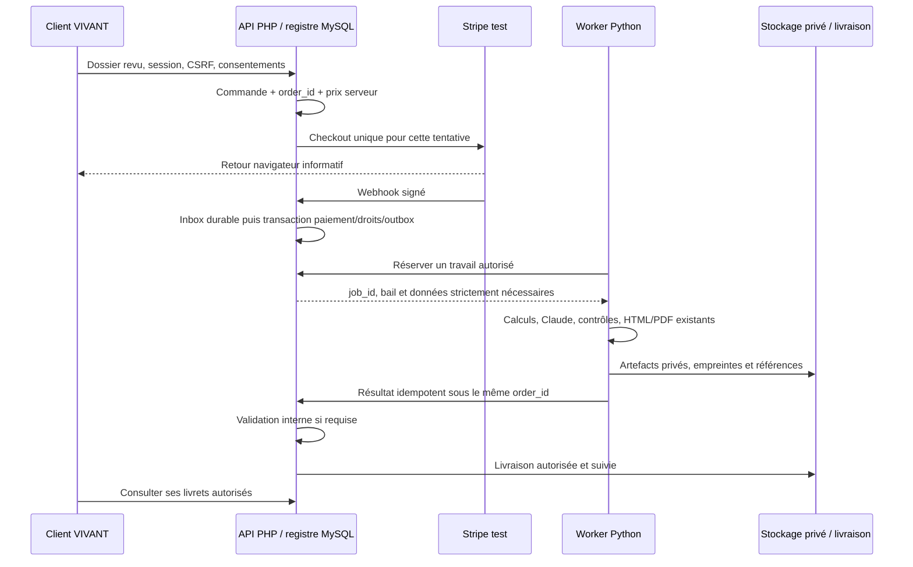

# Proposition d'architecture commune — à valider avant implémentation

> Proposition historique de la revue `32d6b68`. Les décisions générales ont
> depuis été validées par le propriétaire. L'état courant et la migration
> partielle sont décrits dans [audit-followup/ARCHITECTURE_ET_MIGRATION.md](audit-followup/ARCHITECTURE_ET_MIGRATION.md).

Statut : **proposition pour revue indépendante, non implémentée dans cette
mission**. Le moteur Premium et les services existants restent inchangés.

## 1. Autorité métier et responsabilités

**Décision proposée : une seule autorité métier, l'API PHP et sa base MySQL,
pour les comptes, commandes et droits d'accès.** Stripe est l'unique prestataire
de paiement et fait autorité sur les mouvements financiers. La base métier
conserve leur projection vérifiée et décide des droits. Le Python exécute les
travaux autorisés ; il ne crée ni paiement, ni droit concurrent.

| Composant | Responsabilité | Ce qu'il ne décide pas |
| --- | --- | --- |
| Interface VIVANT | Saisie, accord de transmission, affichage et espace client | Prix, paiement acquis, propriétaire d'une commande ou droit de génération |
| API PHP / MySQL | Identité, catalogue, commandes, droits, travaux, accès aux documents et partage | Validité d'un paiement sur la seule foi du navigateur |
| Stripe | Checkout, encaissement, abonnement, remboursement, portail | Accès direct aux données familiales ou exécution du moteur |
| Worker Python | Calculs, narration, contrôles et rendus Premium existants | Paiement ou attribution autonome d'un droit |
| Stockage privé / livraison | Artefacts, validation interne, accès et envoi suivis | Autorisation déduite d'un nom de fichier ou d'un lien permanent public |

Les écritures métier passent par l'API PHP. Un worker n'accède pas directement à
des tables pour accorder des droits. Aucun cookie de compte, secret Stripe ou
clé Claude/Brevo ne passe dans le navigateur comme preuve d'autorisation.

## 2. Écart avec le code actuel

Le PHP possède déjà `subscriptions`, `purchases`, `stripe_events` et la fonction
`entitlement()`, mais **pas encore de registre unifié des commandes et travaux**.
Le Python possède `_stripe_verifier`, un compteur mémoire `_stripe_usages`, des
codes cadeaux et un fichier temporaire de codes consommés. Il ne crée pas de
Checkout dans ce dépôt, mais conserve une autorité d'accès distincte. Le parcours
de paiement du site public n'est pas entièrement présent ni audité ici.

Ces mécanismes ne constituent donc pas aujourd'hui une source unique des droits.
La passerelle locale `origin.booklet-draft` ne résout pas ce problème : c'est un
dossier de saisie, pas une commande payée ou une preuve de consentement serveur.

La cible ne crée pas un deuxième système de paiement Python. Elle consolide
Checkout, portail, événements et droits dans une seule autorité PHP. Les
contrôles historiques Python restent figés pour la revue ; leur transition sera
explicitement approuvée avant toute modification. Aucune désactivation sur le
site public n'est demandée ou effectuée dans cette mission.

## 3. Identifiants et modèle proposé

`order_id` : UUID v4 opaque, créé côté serveur **avant** Checkout. Il est commun
au PHP, à Stripe (`client_reference_id` et métadonnée `origin_order_id`), aux
travaux Python, artefacts et livraisons. Il ne constitue jamais un secret ou une
autorisation. Chaque objet porte aussi `environment` (`test` ou `live`).

| Entité proposée | Identifiants et contraintes essentielles |
| --- | --- |
| Compte | `users.id` existant, unique identité métier ; aucune copie d'identité Python |
| Commande | `order_id`, compte propriétaire, environnement, devise, montant en unités mineures, version de catalogue |
| Ligne | `order_item_id`, commande, SKU autorisé, quantité, version des données et droits requis |
| Tentative de paiement | `payment_attempt_id`, commande, session Stripe unique par environnement ; association conservée côté serveur |
| Événement financier | environnement + `stripe_event_id` uniques ; état de traitement et références minimales |
| Droit | `entitlement_id`, compte/ressource, provenance vérifiée, quantité, réservation, consommation, expiration/révocation |
| Travail | `job_id`, ligne, révision autorisée, bail, état, nombre d'essais et dates de reprise ; unicité ligne + révision + environnement |
| Artefact | `artifact_id`, travail, type, empreinte, taille, emplacement privé, version du moteur et des entrées |
| Livraison | `delivery_id`, artefacts, destinataire autorisé, canal, état, référence du prestataire et tentatives |

Ce tableau décrit un **modèle à concevoir**, pas une migration SQL déjà fournie.
Les références Stripe sont uniques dans leur environnement. Une adresse email,
un prénom ou une date de naissance ne sert pas à fusionner des identités.

La commande conserve son prix et son périmètre au moment de l'achat. Le client
envoie un SKU et des choix autorisés ; le serveur retrouve le prix Stripe,
contrôle le montant et la devise. Réutiliser un Checkout encore valide ; ne pas
créer un nouveau paiement pour une commande déjà payée.

## 4. Chaîne de traitement

Le retour du navigateur ne marque jamais une commande payée. Un accusé de
réception de webhook ne signifie ni génération terminée, ni email livré.
Conserver des états séparés :

- Paiement : `pending`, `paid`, `failed`, `refunded`, `disputed`.
- Travail : `queued`, `leased`, `running`, `retry_wait`, `completed`, `failed`.
- Validation interne : `not_required`, `pending`, `approved`, `rejected`.
- Livraison : `pending`, `sending`, `sent`, `unknown`, `failed`.

Les transitions autorisées, remboursements partiels et effets des contestations
sur les accès doivent être décidés avant développement. Le circuit actuel
envoie les livrets à `EMAIL_DEST` pour validation ; il ne faut pas transformer
silencieusement cette validation interne en livraison automatique au client.

## 5. Webhooks fiables

Un seul récepteur Stripe par environnement pour ce périmètre métier :

1. Lire le corps brut une seule fois, borner sa taille, vérifier la signature,
   l'horodatage et le secret de l'environnement exact. Rejeter le mélange test/live.
2. Inscrire durablement l'événement validé dans une inbox avec contrainte unique
   `(environment, stripe_event_id)` ; acquitter seulement après cette persistance.
3. Résoudre la commande par la session enregistrée côté serveur. Contrôler compte
   Stripe attendu, client, produit/prix, montant, devise et statut du paiement ;
   ne pas faire confiance à la seule métadonnée `origin_user_id`.
4. Dans une transaction, appliquer la transition, actualiser les droits et écrire
   l'outbox. Un doublon ne consomme pas un deuxième droit et ne recrée pas un travail.
5. Traiter les événements désordonnés par rapprochement de l'état Stripe courant
   ou une règle de version validée. Une notification ancienne ne doit pas réactiver
   un abonnement annulé. Prévoir l'échec temporaire de Stripe et les paiements différés.
6. Rejouer les événements échoués avec temporisation bornée et alerte. Réconcilier
   périodiquement les paiements/abonnements ; conserver une piste d'audit minimale.

Le code actuel a une transaction et une déduplication locales testées, mais
n'implémente pas encore cette inbox/outbox complète, le rapprochement des
abonnements ou tous les contrôles métier. Les appels réseau Stripe dans une
transaction longue et l'usage des métadonnées doivent faire partie de la revue.

## 6. Travaux et liaison PHP–Python

Pour rester compatible avec Hostinger mutualisé, le PHP répond à des requêtes
courtes ; le worker durable tourne dans l'hébergement Python distinct. Il peut
réserver une outbox MySQL via l'API métier. Un broker supplémentaire n'est pas
nécessaire au premier parcours si le bail SQL, les contraintes d'unicité, la
reprise et la supervision sont vérifiés sur la version MySQL cible.

Proposition de contrat versionné : `order_id`, `order_item_id`, `job_id`,
`environment`, `revision`, référence des entrées chiffrées, SKU et version du
schéma. Les données sont figées pour ce travail ; une modification du profil
n'altère pas rétroactivement un livret commandé.

Liaison serveur proposée : HTTPS et signature HMAC-SHA256 portant sur méthode,
chemin, environnement, horodatage, identifiant de requête et empreinte du corps.
Les clés sont distinctes par environnement, avec identifiant de rotation,
fenêtre de validité et suivi des requêtes. Le mécanisme de secrets doit fournir
une vraie clé de signature locale ; une valeur substituée uniquement dans un
proxy réseau ne doit pas être utilisée comme une clé HMAC. À confirmer pour les
hébergeurs choisis avant implémentation. Aucun secret dans le front.

Le worker valide son bail et l'autorisation métier avant un appel facturé. Une
réservation de droit et l'unicité du travail empêchent deux exécutions concurrentes
pour une même révision. Les échecs techniques ne créent pas automatiquement une
nouvelle commande payante ; les règles de consommation et de relance commerciale
doivent être validées. Les résultats et callbacks sont idempotents.

Une garantie « exactement une fois » sur tous les appels externes n'est pas
promise : un timeout peut laisser un résultat indéterminé. Utiliser l'idempotence
du prestataire lorsqu'elle est officiellement disponible ; sinon réconcilier
avant de renvoyer un email ou relancer un appel coûteux. Ne pas annoncer « livré »
sur un simple succès HTTP du lancement du travail.

Le choix du point d'entrée autour du moteur et l'éventuelle extraction de
l'orchestration de ses threads doivent être validés par Claude. Aucun prompt,
calcul, enrichissement, contrôle ou rendu n'est changé dans ce dossier.

## 7. Séparation démonstration / test / production

| Périmètre | Données et prestataires | Autorité |
| --- | --- | --- |
| Démonstration | Fixtures fictives, calculs/rendus locaux, Claude/Brevo simulés | Aucun paiement ou droit de production |
| Préproduction | Comptes/base/stockage séparés, vraies clés Stripe **test** et destinataires de test autorisés | Registre métier test uniquement |
| Production future | Comptes, base, secrets, domaines webhooks, stockage et supervision distincts | Registre métier live, après validations explicites |

Les identifiants d'environnement sont contrôlés à chaque frontière. Les fixtures
ne créent pas de commandes live. Aucun repli automatique vers un prestataire
simulé en cas de clé absente ou de panne. Les modules de démo ne sont pas importés
par le point d'entrée de production ; les tests ne servent pas de configuration
de production. Les drapeaux `live_payments_approved`, `family_ready` et
`mirror_paid_ready` restent fermés pendant la revue.

## 8. Données familiales et livrets privés

- Distinguer compte, personne décrite, espace familial et ressource. Créer une
  fiche de proche n'établit ni son identité de compte, ni son consentement.
- Accès refusé par défaut, contrôlé côté serveur pour chaque lecture/écriture,
  génération, export et téléchargement. Un achat ne donne pas accès à toutes les
  données des proches ; un `order_id` ou une URL connue ne contourne pas les droits.
- L'accord de reprise des prénoms/dates n'est pas un consentement général à
  traiter ou partager tous les récits, ressentis et photos. Ne transmettre au
  moteur que les données nécessaires et autorisées pour l'offre commandée.
- Tout partage futur nécessite une invitation temporaire à jeton haché, une
  acceptation liée au compte vérifié, une portée explicite, des rôles et une
  révocation. Ne jamais accepter automatiquement sur correspondance email/date.
- Séparer brouillons privés, propos personnels de chaque participant et synthèse
  partagée. Un administrateur d'espace ne peut pas lire par défaut une note
  individuelle non partagée. Ne pas inventer le témoignage du proche.
- Les mineurs et les représentations légales demandent des règles validées, pas
  une simple case présentée comme une preuve universelle de consentement.
- Le blob actuel de sauvegarde par compte ne fournit pas une ACL fine : il doit
  rester privé tant que les ressources et leurs autorisations ne sont pas
  séparées. Le partage familial inter-comptes n'est pas livré aujourd'hui.
- Stockage et sauvegardes chiffrés au repos, clés hors racine web, accès audités,
  rotation et restauration testées. Aucun chiffrement de bout en bout n'est promis.
- Livrets hors de `public_html`, téléchargement authentifié ou lien temporaire
  de courte durée, contrôlé par la commande et la politique d'accès. Les emails
  ne contiennent pas de jeton permanent donnant accès à toute une famille.
- Journaux sans prompts, dates de naissance, récits ni secrets ; corrélation par
  identifiants techniques. Finaliser conservation, suppression, exports, retrait
  de partage, incidents et obligations comptables avant ouverture.

## 9. Transition sans double autorité

1. Geler et faire auditer la présente base. Aucune migration distante maintenant.
2. Valider cette proposition, le catalogue Solo et le sens exact de chaque droit.
3. Implémenter uniquement en test le registre, l'outbox et l'adaptateur Python.
4. Rapprocher explicitement les sessions, achats, abonnements et codes historiques.
   Ne pas déduire des droits d'un compteur mémoire perdu ou d'une simple adresse
   email ; les cas ambigus attendent une décision, sans droit inventé.
5. Prévoir une bascule approuvée par périmètre : un seul point crée Checkout et un
   seul registre autorise les travaux. Les anciens écrans peuvent devenir clients
   de ce même service ; aucun deuxième checkout ou compteur autonome pour le
   nouveau parcours. Les chemins historiques ne sont pas modifiés ici.
6. Valider en test doublons, concurrence, panne après paiement, crash du worker,
   envoi indéterminé, annulation, remboursement et révocation avant toute ouverture.

## 10. Décisions attendues de la revue

Valider/refuser l'autorité PHP/MySQL, les identifiants, les états, les règles de
réservation/consommation et de relance, le contrat worker, l'authentification
machine et le modèle de consentement/partage. Confirmer les capacités réelles
Hostinger et Python. La reprise prioritaire, après cet accord, sera **un seul
parcours Solo de bout en bout en Stripe test**, pas un nouveau catalogue ou une
activation des abonnements live.
