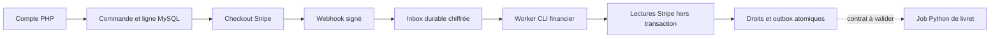

# Migration et exploitation : environnement de test uniquement

Aucune commande ci-dessous n'a été exécutée chez Hostinger. Aucune installation
distante n'est autorisée par ce document. Le site public reste hors périmètre.

## Architecture conservée

PHP/MySQL possède les comptes, commandes, lignes, tentatives, droits et états des
événements. Stripe reste l'unique prestataire de paiement. Python possède les
générateurs existants ; aucun nouveau paiement n'y est créé. L'identifiant UUID
de commande est commun au Checkout (`client_reference_id` et métadonnée), à la
tentative, aux lignes et à l'outbox. Les données familiales ne sont pas copiées
dans les métadonnées Stripe.



La dernière flèche n'est pas implémentée. La table `jobs` réserve l'unicité
ligne/révision/environnement ; elle ne constitue pas un nouveau générateur.
L'outbox enregistre un rapprochement avec des identifiants uniquement et ne
déclenche aucune livraison. Un job Miroir ne peut pas autoriser un livret Solo.

## Migration 004

1. Identifier le schéma existant. Pour une installation vierge, importer le
   `hostinger/vivant/api/schema.sql` complet. Pour une base de test déjà migrée
   jusqu'à 003, utiliser seulement `pack-docs/migrations/004_registry_inbox.sql`.
   Une ancienne base initiale nécessite l'analyse des migrations 002 et 003,
   sans réexécuter leurs ALTER aveuglément.
2. Sauvegarder base ET clés privées et prouver leur restauration sur une copie
   isolée. Les DDL MySQL/MariaDB font des commits implicites : pas de promesse de
   rollback transactionnel de migration. La migration 004 est additive et
   réexécutable (`CREATE TABLE IF NOT EXISTS`), sans supprimer ou réécrire les
   anciennes sauvegardes/achats. Elle ne répare pas une table préexistante mal formée.
3. Garder Checkout et générations désactivés pendant la recette de la copie.
   Installer schéma et code ensemble ; l'ancien code ne doit pas rester un
   écrivain parallèle de commandes/droits.
4. Rapprocher chaque commande historique avec le Stripe du même environnement,
   le bon propriétaire et les lignes/prix/montants/états courants. Les anciens
   achats ne deviennent pas automatiquement des droits. Aucun script d'import
   de vrais clients n'a été improvisé dans cette phase.
5. Recetter le worker et les événements TEST, comparer les droits attendus, puis
   demander la validation du propriétaire avant toute autre installation.

Tables nouvelles : `order_items`, `payment_attempts`, `customer_bindings`,
`entitlements`, `stripe_inbox`, `payment_disputes`, `payment_adjustments`, `jobs`,
`outbox`. Les anciens `orders`, `purchases`, `subscriptions` et `stripe_events`
restent. L'en-tête de commande conserve des colonnes historiques mais le runtime
lit le produit/prix/montant des lignes et la preuve de paiement des tentatives.

Les tests prouvent la migration d'une base synthétique du schéma `dddceec`, la
conservation d'une révision de sauvegarde et d'un achat, l'absence de droit inventé,
la relance de 004 et l'installation complète sur une base vide (20 tables).
Ils ne prouvent pas une migration d'une base réelle inconnue. La version SQL
réelle d'Hostinger reste à fournir ; le worker n'exige pas `SKIP LOCKED` et utilise
un `UPDATE` conditionnel portable, testé uniquement sur MariaDB 11.4.

## Worker financier privé

Le script `tools/vivant/stripe_worker.php` doit rester HORS racine web, avec
l'arborescence privée du projet lui permettant de charger le bootstrap. La
configuration privée doit être désignée explicitement pour CLI par
`ORIGIN_VIVANT_CONFIG`. Ne pas copier le dossier `tools/` dans `public_html`.

Exemple à adapter sur la seule préproduction autorisée, après sa validation :

```bash
ORIGIN_VIVANT_CONFIG=/chemin/prive/origin-vivant-config.php \
  /chemin/php tools/vivant/stripe_worker.php --status
ORIGIN_VIVANT_CONFIG=/chemin/prive/origin-vivant-config.php \
  /chemin/php tools/vivant/stripe_worker.php
ORIGIN_VIVANT_CONFIG=/chemin/prive/origin-vivant-config.php \
  /chemin/php tools/vivant/stripe_worker.php --retry evt_identifiant_verifie
```

Une invocation traite au plus 20 événements. Le cron devra le relancer
régulièrement et surveiller les états `retry`, `blocked`, la plus ancienne
réception et les baux expirés. Une reprise cible seulement les états retry/blocked
sans bail, dans l'environnement de configuration. Dix échecs bloquent l'événement ;
la reprise manuelle suit l'identification/correction de sa cause. L'erreur stockée
est la classe d'exception, jamais la charge fournisseur ou un secret.

Le HTTP 200 signifie « réception durable », pas « droit accordé » ni « livret
livré ». Si la base échoue, la réception renvoie 503 pour permettre à Stripe de
réessayer. Les signatures et le mode sont vérifiés avant insertion. Les doublons
sont uniques par environnement/ID et vérifiés par empreinte du contenu minimisé.
Les lectures fournisseur se déroulent hors transaction ; bail et jeton empêchent
un ancien worker de committer après reprise concurrente.

`https_required=true` reste obligatoire pour les requêtes web distantes. Le CLI
est exempt de contrôle HTTPS car il ne reçoit pas de requête HTTP. `--status` et
un `--retry` inconnu ont été exécutés dans le conteneur privé avec cette option
active ; aucune requête Stripe n'a été faite pour ce contrôle.

## Clés et sauvegardes

- `app_key` reste la clé originale 32 octets encodée base64 canonique, nécessaire
  aux anciens blobs sans préfixe et à la stabilité du limiteur. Ne pas la remplacer
  pour « réparer » une erreur de déchiffrement.
- `encryption_key_id` sélectionne la clé courante dans `encryption_keys` (ou
  `legacy` pour `app_key`). Ajouter une nouvelle clé aléatoire privée dans un
  coffre, conserver l'ancienne dans le trousseau, puis changer l'ID courant.
  Aucun exemple de clé active ou factice n'est fourni dans le dépôt.
- Les sous-clés HKDF séparent sauvegardes, inbox et limiteur. L'AAD inclut aussi
  l'environnement : restaurer une copie de production en environnement test
  n'autorise pas automatiquement à déchiffrer ses blobs ov2.
- Les formats ov1 et initial sont lus, les nouvelles écritures utilisent ov2.
  Une clé inconnue/retirée ou un blob illisible produit un refus de récupération,
  jamais une sauvegarde vide écrasée. Le format initial reste sans AAD historique.
- Conserver les clés de toutes les versions encore présentes : état courant,
  dix versions précédentes, inbox, exports et sauvegardes de base retenus.
  Ne pas retirer une ancienne clé avant vérification exhaustive des références
  et d'une restauration complète. Aucune rotation ni purge distante exécutée.

L'export familial JSON demeure accessible au propriétaire vérifié après
résiliation. La suppression de compte exige sa réauthentification et supprime
état/historique/droits ; le registre financier est détaché et pseudonymisé.
La politique juridique de rétention et la purge restent à valider.

## Accès nécessaires pour la suite

Fournir par des mécanismes privés, sans valeurs de secrets dans le chat :

- Préproduction Hostinger distincte du site public : chemins privés/document root,
  type d'hébergement, PHP CLI/cron, versions MySQL/MariaDB, extensions, HTTPS,
  configuration du proxy et logs d'erreur expurgés.
- Copie autorisée du schéma et inventaire agrégé des commandes historiques,
  état des migrations, coffre des clés et preuve de restauration ; aucune base
  client nécessaire pour la revue initiale du code.
- Stripe TEST : accès au catalogue déjà approuvé, Price IDs et montants exacts,
  version API, endpoint webhook et configuration sécurisée de la clé test/secret.
  Aucun nouveau tarif ou abonnement à créer.
- Configuration du moteur réellement déployé : présence/validité des variables
  de sécurité vérifiée par l'exploitant, URL privée et configuration du service.
  Ne jamais exporter ni afficher les valeurs.
- SMTP/Brevo de test, destinataire de recette autorisé ; accès Claude de test
  uniquement pour la qualité des livrets, après validation des coûts et du parcours.
- Validation du contrat de job/usage durable et des règles financières/droits,
  puis de la rétention et des limites du partage des données familiales.

Prochaine étape prioritaire : faire relire cette branche et valider son registre,
ses règles et sa migration, puis recetter un seul parcours Solo Stripe TEST jusqu'à
un travail durable et une livraison contrôlée. Aucun encaissement réel avant
résolution des limites de consommation/reprise Python et accord du propriétaire.
